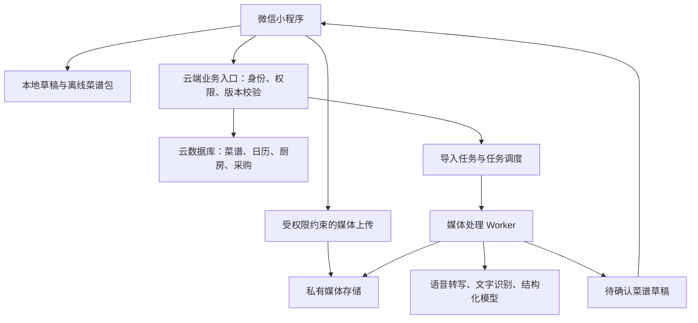

# 食谱项目技术总方案

日期：2026-11-19。状态：建议方案，尚无应用代码和实测环境。

本方案以微信小程序为首发候选、微信云开发为后端候选，便于结合现有开发工具推进。截图只证明用户已安装工具，不证明项目、云环境或付费服务已创建。最终技术栈需通过 P0 验证后锁定。

## 1. 总体架构



划分三个运行场所：手机处理交互、缓存和计时；业务后端处理身份、协作与计算；媒体 Worker 处理转码、抽帧及 AI。短视频不经过小程序包或业务函数代码包传递。

首版采用模块化业务服务；不做多套微服务。长任务 Worker 按需独立部署，不代表现在就要购买容器或 GPU。

## 2. 候选技术栈与选择理由

| 层 | 建议 | 说明 |
|---|---|---|
| 客户端 | 原生微信小程序、TypeScript、WXML、WXSS | 避免初期同时维护 App 和跨端适配；构建方式需验证 |
| UI | 原生组件优先，必要时评估 TDesign 小程序组件 | 先确定设计规范，再引入依赖，不把 UI 库作为业务基础 |
| 本地结构数据 | 小程序存储 API，经统一 repository 封装 | 不直接沿用浏览器 IndexedDB 方案 |
| 本地媒体 | 文件系统 API 与持久文件目录 | 临时路径不等于永久离线保存；配额和清理行为待测 |
| 业务后端 | 微信云开发普通事件云函数，Node.js/TypeScript 构建 | 小程序原生调用，不先增加 HTTP 网关 |
| 在线业务数据 | CloudBase 文档数据库 | 必须重新落地关系约束、索引与事务，不能照搬 SQL |
| 媒体 | 私有云存储、本地离线副本 | 媒体访问权限与业务数据权限分别处理 |
| 媒体 Worker | Python 或 Node.js + FFmpeg，按团队熟悉程度选一套 | 独立执行长任务，运行环境、依赖许可与资源待确认 |
| AI | 可替换的 ASR/OCR/结构化模型适配器 | 尚未选供应商；不强制三类调用全部启用 |
| 测试 | 纯业务单元测试、云端集成测试、开发工具及真机验证 | 具体测试框架开发时选定 |

不锁定尚未查证的框架版本。首次实现时记录 SDK、基础库、运行时及工具版本。

## 3. 工程目录建议

```text
食谱项目/
  README.md、AGENTS.md、知识索引.md
  01-产品/ ... 05-记录/       # 已有知识库
  app/                       # 未来代码，尚未创建
    project.config.json
    miniprogram/
      app.ts、app.json、app.wxss
      pages/                 # 今日、菜谱、日历、厨房
      packages/              # 导入、编辑、跟做等按需分包
      components/            # 食材行、步骤卡、采购项等
      services/              # 云调用与本地数据访问
      repositories/          # local/cloud 数据源适配
      domain/                # 采购计算、人数换算、状态机
      types/                 # DTO 与领域类型
      utils/                 # 日期、定点数、错误处理
    cloudfunctions/          # 实际函数目录按部署工具要求生成
    packages/domain/         # 可共享纯逻辑，构建时打入部署产物
    workers/media/           # 独立媒体处理，后续阶段
    tests/
    scripts/
    config/
```

这是新建自有项目目录，不是下载 GitHub 项目；以后若下载外部项目仍遵循桌面 GitHub 项目库规则。配置中的 miniprogramRoot/cloudfunctionRoot 与目录一致；不要把云端密钥放进客户端配置。共享代码须打包进各部署产物，不能依赖云端不存在的上级相对路径。

## 4. 前端模块与状态

主导航为今日、菜谱、日历、厨房。详情、编辑、导入复核、食材核对、采购清单、跟做、邀请接受为子页。导航仅传对象 ID 和允许的筛选条件，不把整份菜谱塞进 URL。

所有页面统一处理 loading、empty、error、offline、permission_revoked。业务状态和页面展示状态分开，防止一个页面修改后另一个页面保留过期清单。普通列表分页、媒体懒加载，长步骤图做缩略图；不要一次性把所有视频和菜谱载入内存。

表单自动保存本地草稿，但厨房正式写入需联网并通过版本校验。模型结果先进入编辑草稿，不直接覆盖用户菜谱。身份失效或切换账号时隔离本地数据。

## 5. 数据模型如何落地到文档数据库

原数据模型是逻辑实体，不代表每个实体必须单独建表。建议第一版实际集合如下：

| 集合 | 建议内容与边界 |
|---|---|
| users | 内部 user_id、平台身份映射、显示资料；不向成员暴露 OPENID |
| kitchens | 厨房名称、owner、时区和版本 |
| kitchen_members | 厨房与用户、角色；需要唯一性与原子校验 |
| invitations | 令牌哈希、到期、次数、撤销状态 |
| recipes | 基本信息、来源、食材和步骤元数据嵌入同一有界文档 |
| media_assets | 文件标识、空间归属、大小、类型、处理和删除状态 |
| meal_plans | 某日某餐与有界菜品数组、份数、版本 |
| shopping_lists | 日期范围、来源指纹和清单版本 |
| shopping_items | 每项独立文档，便于多人分别勾选；带来源贡献快照 |
| import_jobs | 输入引用、阶段、重试、租约、结果和错误 |
| cooking_notes | 备注作者、菜谱与空间 |
| audit_events | 关键操作、操作者、版本及时间 |
| idempotency_records | 请求幂等键、调用者、请求摘要和结果引用 |

食材步骤嵌入可减少读次数，但须设应用级上限；过大时拆分，不在单文档放图片二进制或转写全文。跟做快照和计时实例优先本地保存，暂不跨设备同步。

候选索引：菜谱按空间+状态+更新时间+ID；厨房成员按厨房+用户；日历按空间+日期+餐次；采购按清单+分类+ID；任务按状态+下次运行时间。索引语法、唯一索引能力与事务限制在实现时查证。

文档库没有可直接假定的 SQL 外键级联；所有跨对象引用需业务校验。唯一成员关系可使用确定性文档键配合事务，不能只“先查再新增”。

数量在 JSON 中用十进制字符串或约定精度的整数，服务端与客户端共用计算规则；数据库数值类型不能代替业务精度设计。日期用 YYYY-MM-DD 加计划时区，记录时间使用 UTC。

## 6. 身份、权限与分享

使用小程序关联的云开发原生调用链。业务函数从可信调用上下文取得身份，映射内部 user_id；不接受客户端声明“我是某个 OPENID”。UNIONID 为可选信息，不作为首版必填字段。昵称头像独立于身份，不默认获取微信好友关系。

个人资源由本人访问；厨房资源按 owner/editor/viewer 校验。成员关系、角色、资源归属都由后端验证。已有登录身份不代表有厨房访问权。

简单私人 CRUD 可在严格安全规则下直接使用数据库 SDK；厨房成员管理、清单刷新、邀请与跨对象修改走业务云函数。对服务端可能使用的管理权限必须显式校验业务授权，不依赖客户端数据库规则兜底。

加入厨房：创建带过期和使用次数限制的邀请 → 微信分享或二维码传递入口 → 接收者打开并明确接受 → 后端检查邀请与身份 → 原子建立成员。仅打开分享页不自动加入。二维码及分享参数的长度、有效性与平台能力需实测。

私人菜谱复制到厨房后成为独立对象，媒体需有独立授权引用或副本。后续修改原稿不自动覆盖家庭版。公开菜谱分享另行设计，不能把邀请功能等同公开发布。

## 7. API：从通用 REST 到小程序云函数

已有 REST 文档保留为通用业务契约。首版小程序优先 wx.cloud.callFunction，输入采用 {action, payload, expectedVersion, idempotencyKey}；函数内按明确 action 白名单分发，不执行用户传入的方法名。

建议按业务领域分入口：recipeService、kitchenService、mealService、shoppingService、importService。不是一个无限扩张的万能函数，也不必每个按钮建一个函数。

返回 {ok, data, error, requestId}。原 REST 的 409 在云函数模式映射为 VERSION_CONFLICT 业务码；不要依赖 SDK 自动提供相同 HTTP 状态。参数校验、空间鉴权、版本与幂等校验统一封装。

一次写操作流程：验证输入 → 取可信身份 → 验证资源与角色 → 事务校验版本 → 写入与递增版本 → 记录审计 → 返回最终状态。幂等键绑定身份和请求摘要，同键不同内容必须拒绝。

## 8. 视频导入的三条路径

A：粘贴分享文案，提取并校验 URL，先保存来源；有经验证的可用解析方式才继续取得媒体。

B：用户选择有权使用的本地视频，持久化或授权上传；是自动整理的重要备用入口。

C：用户上传截图、粘贴字幕或手动填写；没有视频仍可建菜谱。

链接、视频文件、结构化菜谱是三个不同对象。解析失败不丢失链接，不提示“已离线保存视频”。不得假设普通视频播放器可以直接打开任意抖音分享页。

uiautomator2 仅可作为独立安卓设备实验工具，不放入小程序，不要求普通用户开启调试或运行 Python，也不作为线上服务的前提。

## 9. 媒体与 AI 流水线

1. 校验来源、媒体类型、真实文件头、大小和时长；明确是否允许上传及交给外部 AI。
2. 创建任务并返回 job_id，手机显示阶段，不阻塞等待整个视频处理。
3. Worker 获取媒体、提取音轨；优先利用已有可靠字幕，无字幕再转写。
4. 按需 OCR 提取画面用量；按时间筛选候选关键帧。
5. 结构化模型生成食材、步骤、时长候选与证据时间区间。
6. 用 JSON Schema 和业务规则校验：数量未知可空、时间不能越界、食材引用须存在。
7. 生成可编辑草稿，突出冲突和缺失；用户确认后正式保存。

模型不负责直接执行工具、发邀请、改库存或决定采购量。视频中的文字是输入数据，不是系统指令。若字幕和画面冲突，两种证据都保留，由用户选择，不让模型悄悄裁决。

AI 适配层分别提供 transcribe、recognizeFrames、structureRecipe。模型、提示词版本、输出 schema 版本、调用费用和结果摘要记录到任务，不把原始私有内容记入普通日志。

不先指定模型供应商或套餐。比较中文转写效果、时间戳、结构化输出、隐私、延迟、限额与实际费用。首版可用转写+少量截图分析，不默认把全部视频帧送入昂贵模型。

## 10. 长任务可靠性

状态采用 queued/acquiring/extracting/structuring/awaiting_review/completed/failed/canceled，与已有导入文档一致。awaiting_review 才表示机器完成，completed 表示用户确认保存。

持久任务队列或可恢复任务表管理执行；进程内后台 Promise 不保证任务存活。Worker 用租约、心跳和 attempt 领取任务，超时可重领；按至少一次执行设计每阶段幂等。失败区分可重试网络错误和不可重试输入错误，设置有界重试与退避。

取消需要停止后续阶段并清理临时资源；已发生外部调用不承诺立即退款。上传、处理、人工审核分别计时，阶段进度无依据时不显示虚假百分比。

## 11. 截图和本地菜谱包

服务端抽帧建议保存 source_media_id、timestamp_ms、step_id 与图片引用。截图和原视频建立来源关系，允许用户换帧。客户端精确选帧能力需要验证，不能默认 canvas 可以任意抓取播放器画面。

离线菜谱包包含确认版文本、食材、步骤图和来源；完整视频为可选项。下载后逐文件校验再标记可离线，过期的临时下载 URL 不能作为离线资源。

包包含 schema_version、recipe_version、媒体清单与校验值。更新通过新包写完后切换引用，失败保留旧包。提供容量查看、手动清理和备份导出。共享内容已被下载后无法承诺远程撤回；退出厨房时清除应用可控缓存。

## 12. 跟做与计时

跟做开始保存菜谱步骤快照，避免家人修改影响当前操作。每个定时器保存 label、duration、deadline、状态、暂停剩余时长；重复点击启动须去重。

前台每秒刷新只是显示机制，真实剩余时间根据 deadline 计算。暂停冻结剩余时长，恢复建立新 deadline；关闭页面不自动取消。手动改变系统时钟可能影响绝对时间，应检测明显异常并提示确认。

常亮只在跟做页面按需开启。小程序后台、锁屏、微信退出或进程结束后能否响铃不能按普通原生 App 推断。订阅消息不能当作精确秒级闹钟替代。必须在目标手机实测；首版准确表达前台计时和返回恢复能力，必要时建议用户使用系统计时器。

## 13. 日历与采购算法

日历以厨房时区解释日期，按早餐/午餐/晚餐等槽位排列，支持自由文本。每道菜可覆盖人数；没有基础份数则不自动缩放。

采购算法必须确定性执行，不交给模型算数：排餐快照 → 人数换算 → 食材别名规范化 → 可换算单位统一 → 汇总 → 用户核对 → 扣减已有 → 保存来源快照。

不同单位无法换算时分行；“盐适量”不当作 0；老抽、生抽不合并。部分已有量不可重复扣减。多张清单不自动占用库存，避免同一库存被重复视为可用而无提示。

同一菜单版本重复生成复用预览。菜单变更先展示差异，确认时校验指纹及清单版本。已买记录和手动项目保留。详细公式与样例见采购计算规则文档。

## 14. 搜索、同步与离线

初期按菜名、作者、食材规范名称与标签查询；不承诺数据库默认提供中文分词全文搜索。小规模离线包可本地索引，线上使用索引字段和分页；规模增长后再评估专用搜索服务。向量检索不是首版依赖。

个人本地数据和云端对象分配不同标识，显式迁移时才上传。共享空间首版只允许在线写，离线可看已缓存内容。回网后先刷新，不无条件重放旧操作。

两个成员同时修改同版本时，一次成功，一次冲突；界面展示最新内容并允许重试。认领和购买是不同字段，购物项独立版本，避免整份清单互相覆盖。实时推送仅增强体验，页面刷新仍可得到正确结果。

## 15. 权限、运行安全和恢复

数据库、函数入口、文件存储三层分别验证权限。私有媒体用受控短期读取方式，检查媒体是否属于当前空间。不能只隐藏前端按钮，也不能让媒体目录命名代替权限。

云密钥仅后端配置，分开发/测试/生产环境。远程媒体获取限制协议、域名与解析后 IP，防止请求内网；每次重定向重新校验，并限制大小、时长和超时。AI 输出也必须验证，不能直接渲染为可执行内容。

删除使用软删除和定期清理，清理前检查媒体引用；私人原稿与厨房副本共用物理文件时，删除一方不能破坏另一方。具体保留期上线前确定。

备份范围包括业务数据、媒体及配置索引；发布前实际做恢复演练。应用回滚与数据迁移分别计划，破坏性 schema 变更不与普通页面发布混在一起。

## 16. 可观测性与成本

按 request_id/job_id 关联业务和处理日志；监控导入成功率、各阶段耗时、人工修改、任务积压、云调用失败和权限拒绝，不记录完整私人视频或访问令牌。

月成本估算 = 数据库存储及读写 + 媒体容量与流量 + 云函数资源 + Worker 资源 + ASR 分钟数 + 模型输入输出。尚无供应商和用量，不给虚构报价。

设置单任务媒体上限、用户日导入额度、重试次数、费用告警和功能开关。配额阈值通过样本实测决定，达到上限时允许继续手动建菜谱。

## 17. 开发与测试顺序

P0：确认 AppID/环境关联、目标平台版本；10 条视频验证媒体获取、转写、步骤与截图；真机验证计时和文件保存。

P1：手动菜谱 → 本地图片 → 搜索 → 日历 → 核对 → 采购 → 跟做 → 导出恢复。先证明没有 AI 也能完成一餐。

P2：身份、厨房邀请和权限 → 私人复制 → 共享排餐与采购 → 双设备并发、退出和恢复验证。

P3：本地视频与异步 AI 导入 → 草稿复核 → 处理故障恢复 → 按验证结果加入链接解析。

自动化优先覆盖换算、合并、差异、状态机、幂等、权限与并发。真机覆盖视频上传、存储、锁屏、通知、分享与弱网，模拟器结果不能替代真机。

发布分开发、体验和正式阶段；云端变更先验证权限与备份，功能开关支持关闭导入而保留已存菜谱。尚未进行任何预览、部署或发布。

## 18. 已安装技能分工与缺口

- miniprogram-development：目录、页面、配置和调试方案。
- auth-wechat-miniprogram：原生调用身份。
- cloudbase-document-database-in-wechat-miniprogram：客户端文档数据库访问与规则。
- cloud-functions：确需服务端权限或业务逻辑的函数。
- cloudbase-code-review：代码完成后的检查，不能代替测试。

已安装技能引用的部分同级协议与其他技能未随五项单独安装。当前仅做技术文档，不受代码修改或部署前置协议阻塞；开始实际代码和部署前核对这些依赖，按需要补齐，不假定工具已连接。

自动化调试路线建议验证 Nightly 开发工具与 wechatide；当前尚未检查其安装状态。不要把桌面已有开发工具当作已具备该连接能力，也不在本次任务中自动安装或替换工具。

## 19. 必须先解决的技术问题

1. 首发是否确认微信小程序、云开发是否已开通并绑定。
2. 常用安卓/iPhone 机型与最低支持范围。
3. 可处理视频的合法可用获取入口；链接失败的实际回退体验。
4. 外部 AI 授权、供应商与预算。
5. 后台计时能力与产品承诺边界。
6. 本地容量、导出途径与卸载恢复需求。
7. 厨房共享读写及私有媒体的真实权限测试。

## 20. 官方参考与核实边界

查阅日期：2026-11-19。以下为后续实施入口，API 参数、配额与版本以实际部署时文档为准。本次未运行平台功能测试。

- [CloudBase 普通云函数调用](https://docs.cloudbase.net/cloud-function/how-use)：小程序原生调用路径。
- [云函数访问控制](https://docs.cloudbase.net/cloud-function/security-rules)：函数入口权限，不能替代业务授权。
- [数据库安全规则](https://cloud.tencent.com/document/product/876/41802)：区分客户端规则与后端访问边界。
- [微信小程序 API 参考](https://developers.weixin.qq.com/miniprogram/dev/api/)：媒体、文件、存储和页面能力待实施时逐项核实；本次搜索未取得各 API 页面全文。
- [uiautomator2 项目](https://github.com/openatx/uiautomator2)：安卓设备自动化，仅用于独立实验。

本方案与旧文档有分工：技术总方案规定当前候选落地方式；数据模型保留逻辑对象；接口与同步保留通用业务契约。选择并验证平台后，再生成真实集合定义、接口类型与部署配置。
